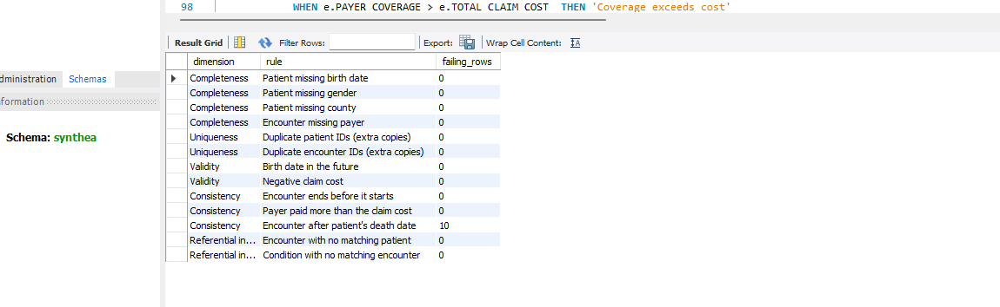
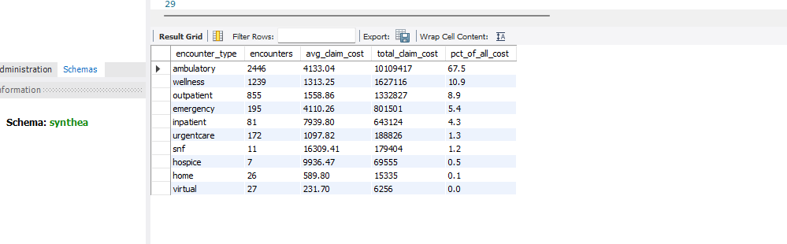
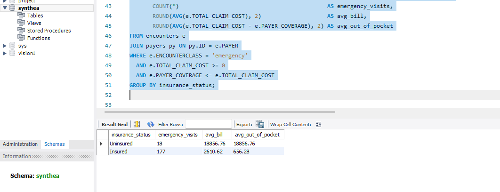
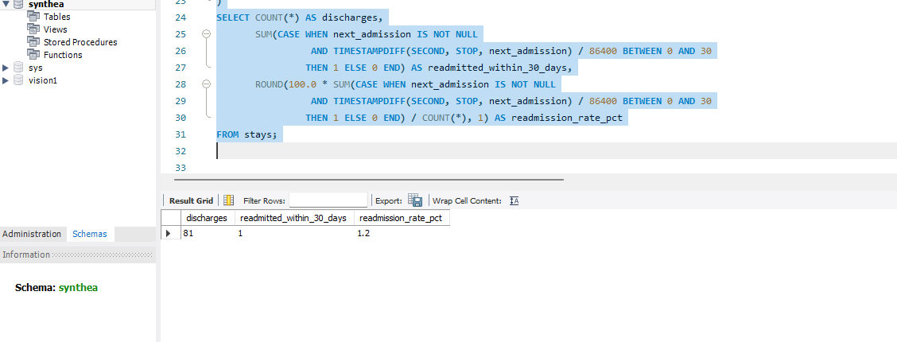

# Healthcare Cost & Utilization Analysis (SQL)

Analysis of a synthetic patient population using SQL: a data quality audit first, then patient demographics, hospital utilization, chronic disease, insurer coverage and readmissions.

**Tools:** SQL (MySQL 8 and SQLite versions), Python (pandas) for loading, MySQL Workbench / DB Browser for SQLite
**Data:** [Synthea](https://synthea.mitre.org/) synthetic patient records (no real patients, no privacy risk)

---

## Business questions

1. **Can the data be trusted?** Completeness, duplicates, invalid values and broken links between tables.
2. **Who are the patients?** Age, gender, location, mortality and income.
3. **Where does the money go?** Visits and cost by encounter type, yearly trends, length of stay.
4. **What is the disease burden?** The most common and most persistent conditions, and diabetes plus hypertension.
5. **Who pays?** Coverage rates by insurer and the out-of-pocket gap for uninsured patients.
6. **How often do patients come back to hospital?** The 30-day readmission rate, a standard hospital quality measure.

## Key findings

Dataset: Synthea sample of **111 patients** and **5,059 encounters** totalling **$15.0M** in claims.

| Area | Finding |
|---|---|
| **Data quality** | 12 of 13 quality rules passed with zero failures. One consistency rule flagged **10 encounters dated after the patient's recorded death date**, which were set aside for review before analysis. |
| **Where the money goes** | Ambulatory visits were **48% of encounters but 67.5% of total cost** ($10.1M, avg $4,133 per visit). Hospital stays were only 81 encounters and 4.3% of cost. |
| **Chronic disease** | Hypertension rises sharply with age: **0% of patients under 35 vs 42.9% of those 65+**. Diabetes: _update after re-running file 04, Q3_. |
| **Insurance gap** | Uninsured emergency visits averaged **$18,857, all paid out of pocket**, vs **$656 out of pocket** for insured patients (avg bill $2,611), about **29x more** per visit. (Based on 18 uninsured visits, a small sample.) |
| **Readmissions** | **1 of 81** hospital discharges was readmitted within 30 days, a **1.2%** readmission rate. |

| Data quality scorecard | Cost by encounter type |
|---|---|
|  |  |
| **Emergency visits: uninsured vs insured** | **30-day readmissions** |
|  |  |

## Project structure

```
├── README.md
├── mysql/
│   ├── 00_create_and_load.sql           # creates tables + loads CSVs inside MySQL Workbench
│   ├── 00_create_and_load_uploads.sql   # same, reading from MySQL's Uploads folder
│   ├── load_data_mysql.py               # alternative: load the CSVs with Python
│   └── queries/                         # MySQL 8 versions of the six files below
├── load_data.py                         # loads Synthea CSVs into SQLite (synthea.db)
├── queries/                             # SQLite versions
│   ├── 01_data_quality_checks.sql       # quality scorecard across 5 dimensions
│   ├── 02_patient_demographics.sql      # age bands, counties, mortality, income
│   ├── 03_encounters_and_costs.sql      # visit types, trends, length of stay
│   ├── 04_conditions_and_medications.sql# prevalence, comorbidity, drug costs
│   ├── 05_payer_coverage.sql            # insurer coverage, out-of-pocket cost
│   └── 06_advanced_window_functions.sql # readmissions, rankings, running totals
└── images/                              # screenshots of key results (MySQL Workbench)
```

## SQL skills demonstrated

- Joins across 5 tables (`INNER`, `LEFT` for orphan-record checks)
- Aggregation with `GROUP BY` / `HAVING`
- Common table expressions (`WITH`)
- `CASE WHEN` for age bands, income bands and quality rules
- Window functions: `LEAD`, `LAG`, `ROW_NUMBER`, `DENSE_RANK`, running `SUM() OVER`
- Date arithmetic on ISO timestamps
- Data quality rules covering completeness, uniqueness, validity, consistency and referential integrity

## How to run it

The queries come in two versions with identical results: MySQL (`mysql/queries/`) and SQLite (`queries/`).

### Option A: MySQL Workbench

1. **Get the data.** On the [Synthea downloads page](https://synthea.mitre.org/downloads), download the 1,000-patient sample in **CSV** format and unzip it.
2. **Copy the CSV files** into `C:/synthea_csv` (or edit that path in the script).
3. **Allow local file loading** (one time):
   - Run `SET GLOBAL local_infile = 1;` in Workbench.
   - *Database → Manage Connections →* your connection *→ Advanced*, add `OPT_LOCAL_INFILE=1` under *Others*, then reconnect.
4. **Create and load the database.** Open `mysql/00_create_and_load.sql` and run it. It creates the `synthea` database, builds typed tables (DATE, DATETIME, DECIMAL), loads each CSV with `LOAD DATA`, adds indexes, and ends with a row count for every table.

   *Getting Error 2068?* Use `mysql/00_create_and_load_uploads.sql` instead: copy the CSVs into MySQL's Uploads folder (`SHOW VARIABLES LIKE 'secure_file_priv';` shows where) and run it. No local-file setting needed.

   *Alternative:* `pip install pandas sqlalchemy pymysql`, then `python mysql/load_data_mysql.py path/to/csv --user root`.
5. **Query it.** In MySQL Workbench, connect to your server, open a file from `mysql/queries/` (*File → Open SQL Script*), and click the lightning bolt to run every query. Each result appears in its own tab.

### Option B: SQLite

1. **Get the data.** On the [Synthea downloads page](https://synthea.mitre.org/downloads), download the 1,000-patient sample in **CSV** format and unzip it.
2. **Load it:**
   ```bash
   pip install pandas
   python load_data.py path/to/csv
   ```
   This creates `synthea.db` with the patients, encounters, conditions, medications, payers, organizations and providers tables.
3. **Query it.** Open `synthea.db` in [DB Browser for SQLite](https://sqlitebrowser.org/), go to *Execute SQL*, open a file from `queries/` and run each query (Ctrl+Enter runs the one under the cursor).

## Approach

The data quality audit runs first because every later number depends on it. Rows that fail validity checks (negative costs, encounters that end before they start, coverage above the billed amount) are excluded from the cost analysis, and `DISTINCT` patient IDs guard against duplicate records. This mirrors how real healthcare claims are validated before reporting.

---

*Author: Prince Yeboah Ntim · [LinkedIn](https://linkedin.com/in/mrprinceglobal)*
